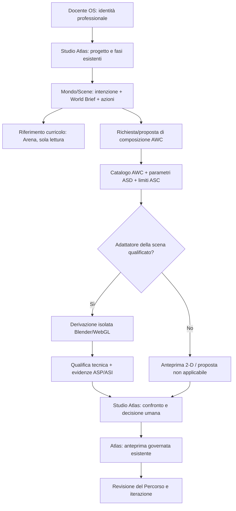

# AWC → Studio Atlas — Progettazione del compositore di mondi per l'ideatore
**Proposta di prodotto e specifica di integrazione v1 — 20 novembre 2026**

Stato: **DESIGN_CANDIDATE / HUMAN_PRODUCT_REVIEW_REQUIRED / NOT_STUDENT_AUTHORIZED / NO_DEPLOY**.  
Perimetro: repository Atlas, PR #136 (infrastruttura AWC-A–F); prodotto professionale **Studio Atlas**, di competenza TRAMA; non biblioteca 3-D e non editor di Arena.  
Decisione fondamentale: **l'ideatore progetta un'esperienza educativa; il compositore aiuta a costruire e verificare un ambiente coerente. Non si parte dal modellatore tridimensionale.**

## 1. Evidenze, fonti e distinzione di autorità

- Infrastruttura AWC-A–F: catalogo, 54 osservazioni, compositore, adattatore orbitale reversibile, doppia derivazione Blender/WebGL, prova di trasferimento alla Sala Zero di MUSEO ZERO. Revisione tecnica F `f7799db47dc83e952d55c45e285a77b0caef2235`, 11/11 procedure applicabili PASS, ricevuta privata archiviata. **È dimostrato il riuso di un solo parametro tipizzato (`camera.orbit`) e della procedura sperimentale, non un generatore universale.**
- TRAMA `docs/decisions/trama-adr-020-studio-atlas-product-boundary.md`: Studio Atlas dominio separabile di authoring. `docs/capabilities/atlas-percorsi/product/CREATOR-STUDIO-PRODUCT-VISION-v0.1.md`, `CREATOR-JOURNEY-v0.1.md`, `CREATOR-ROLES-AUTHORITY-v0.1.md`, `PATHWAY-AUTHORING-PACKAGE-v0.1.md`, `COMPACT-LEARNING-WORLD-SPEC-v1.md`: **fonti normative da rispettare**; questo documento è una proposta applicativa derivata, non una loro sostituzione.
- Prodotto Studio Atlas esistente: `trama-ecosistema/products/studio-atlas/components/PathwayWorkspace.tsx` espone Idea/Storia/Mondo/Esperienza/Scene/Produzione/Prova/Revisione; `AuthoringEditors`, `lib/model.ts`, `lib/production.ts`, `lib/preview.ts`, `lib/preview-bridge.ts` gestiscono bozza, preparazione e anteprima. La persistenza visibile in `lib/store.ts` usa `localStorage`: **non è ancora una custodia professionale multidevice**. Il modello prodotto S1 prescrive identità professionale e revisione concorrenziale; prima di dichiarare il prodotto operativo verificare l'effettivo deployment e la disponibilità delle implementazioni, non inferirli da specifiche.
- Atlas `src/features/pathways/studio-atlas-preview-adapter.ts` e `studio-atlas-preview-bridge.tsx`: anteprima non pubblica che riusa `PathwayRuntimeSurface` ed `ExperienceRuntime` con digest, origine esatta, canale casuale, ACK e dati volatili; l'interfaccia del compositore non crea un secondo player, né inserisce URL di asset privati nei collegamenti.
- Arena mantiene terminologia, struttura, versione e approvazione del **curricolo**. Docente OS mantiene identità e contesto professionale. TRAMA mantiene schema, qualità e governance. Studio Atlas produce la proposta creativa; Atlas gestisce la consultazione e, separatamente, la pubblicazione autorizzata. L'eventuale classe originaria non è requisito per il progetto riutilizzabile.

## 2. Promessa del prodotto

Un docente o progettista, anche senza conoscenze di Blender, può:
1. descrivere che cosa vuole far vivere e imparare, da un'idea o da una bozza già esistente;
2. vedere **alternative di rappresentazione coerenti**, sempre tra cui la più leggera 2-D;
3. approvare o correggere il ruolo attivo dello studente, informazioni distribuite, conseguenze, accessibilità, storia e collegamenti al curricolo;
4. scegliere una singola scena e costruirne un'anteprima visiva;
5. regolare poche proprietà comprensibili, **vedere il cambiamento, confrontare e ripristinare**;
6. provare l'esperienza nel vero percorso Atlas, verificare l'esito e conservarne la decisione.

La creazione di un mondo è parte del **Percorso**: non è un progetto tecnico indipendente che impone 3-D a esperienze dove una soluzione 2-D è didatticamente migliore.

### Caso guida
**MUSEO ZERO — Sala Zero**: un visitatore attraversa il nuovo ingresso ma la proiezione parte in ritardo. L'ideatore deve poter stabilire *che cosa osservare* (sensori, percorso, proiezione), *quale azione simulare* (A/B) e *che cosa cambierà* (ritardo/sincronia). La prova AWC-F ha già creato una scena 3-D tecnica isolata; **non sostituisce** la storia, le quattro ambientazioni, gli otto indizi o la logica del prodotto 2-D. World Brief sorgente: TRAMA `docs/capabilities/atlas-percorsi/pathways/PW-STRATEGY-SELECTION-01/worlds/MUSEO-ZERO/world-brief-v1.md`. Non si promuove la scena tecnica a risorsa canonica.

## 3. Architettura dell'esperienza d'uso — NON una nuova app

Conservare gli otto passaggi Studio Atlas già implementati. Aggiungere capacità a **Mondo**, **Scene**, **Produzione** e **Prova**:

| Fase esistente | Domanda leggibile dall'ideatore | Nuova funzione mirata | Cosa non esporre |
|---|---|---|---|
| Mondo | «Dove siamo? Qual è il compito? Cosa cambia?» | Scheda mondo + mappa di luoghi, ruolo, indizi e conseguenze; confronto 2-D/3-D | World Brief JSON, shader, motori |
| Scene | «Cosa vede, osserva e fa lo studente qui?» | Scena selezionabile, oggetti d'interesse, evento e cambiamento, stato prima/dopo | mesh IDs, YAML |
| Produzione | «Come rendere visibile la scena?» | Rappresentazione, materiali/atmosfera, inquadratura, **Genera prova locale** solo con capacità autorizzate | pipeline, job ID, provider, GitHub |
| Prova | «Funziona come esperienza per lo studente?» | Anteprima governata esistente; confronto, rilievo annotabile e ripristino | falso player interno, pulsante pubblicazione |

### Layout desktop (struttura)
- **Testata:** titolo del Percorso; stato in italiano; «Salvato / Salvataggio in corso / Non salvato»; azione principale della fase; accesso «Vedi come studente» quando consentito.
- **Navigazione laterale:** progressione esistente, non menu parallelo AWC. La fase «Mondo» espande «Idea del mondo», «Luoghi e azioni», «Aspetto» solo quando utile.
- **Area centrale dominante:** tavola delle scene o anteprima visiva; confronto A/B quando c'è una versione valida. Niente pila di schede decorative che sostituisca la scena.
- **Pannello contestuale destro:** proprietà della selezione, breve motivazione educativa, provenienza e controlli. Chiuso inizialmente su telefono.
- **Azioni chiare:** «Prova una variazione», «Confronta», «Ripristina», «Conserva proposta» (non «Approva» automaticamente).

### Layout mobile
Una sola area principale per volta: **Mondo | Scena | Proprietà**; pannelli secondari a comparsa, azione primaria raggiungibile, pulsante Ripristina sempre disponibile. Misure di prova almeno 320/390 px e testo ingrandito al 200%, senza scorrimento orizzontale obbligato per completare la progettazione. Zoom/rotazione con controlli accessibili da tastiera e da pulsanti, non soltanto gesti. Modalità «movimento ridotto», descrizione testuale/illustrata degli stati e alternativa 2-D se WebGL non parte.

## 4. Sequenza concreta dell'ideatore

**Ingresso:** un progetto Percorso esistente. «Mondo» mostra i contenuti già salvati in `PathwayProject.world` e le scene esistenti; non chiede nuovamente dati già forniti.

**Passo A — Intenzione educativa e narrativa.** Mostrare in parole semplici: obiettivo, ruolo, luoghi, situazione osservabile, informazione distribuita, azioni possibili, conseguenze, artefatto significativo e trasferimento. Collegamento curricolare soltanto mediante ref/versione approvata in Arena; se assente presentare «Da collegare», senza inventare corrispondenze.

**Passo B — Modalità visuale.** Confrontare tre direzioni *funzionali*, non tre impianti grafici già promessi: (1) scena illustrata 2-D con elementi attivi; (2) ambiente 3-D leggero con oggetti essenziali; (3) uso combinato dove la profondità aggiunge orientamento. Spiegare per ciascuna l'azione supportata, la qualità delle risorse disponibili e il costo tecnico indicativo. L'ideatore sceglie; la 2-D resta sempre disponibile.

**Passo C — Tavola scenica.** Selezionare una sola scena e associare ad ogni oggetto *una funzione*: ambiente/indizio/personaggio/segnale/interazione; descrizione accessibile; stato di riferimento; conseguenza delle azioni; collegamento alla scena narrativa esistente. Nessun oggetto nasce come decoro obbligatorio.

**Passo D — Variazione.** Controlli umani iniziali **solo per parametri effettivamente collegati e qualificati nell'ambiente corrente**: nel pilota è la rotazione dell'inquadratura. Interventi su materiali, geometria, luce e audio sono **non disponibili** fino a un adattatore e revisione specifici; non mascherare come operativi i 54 dati sperimentali AWC-B. La vista indica «Originale», «Proposta», «Ripristinato».

**Passo E — Prova e decisione.** La procedura produce su copia isolata un'anteprima e le evidenze tecniche; l'ideatore osserva e annota «mantieni», «modifica», «scarta», senza alterare la scena sorgente. Lo stato del Percorso, gli esiti di revisione e le versioni approvate non vengono mutati da una generazione automatica. L'anteprima studente vera resta la funzione governata di Atlas, non una nuova finestra che bypassi i contratti.

## 5. Oggetti informativi — mappatura, non seconda autorità

**Già esistenti (riuso):**
- `PathwayProject`: id, titolo, idea, destinatari, stato, revision, storia, world, experience, scenes, review, produzione.
- `WorldDraft`: learnerRole, canObserve, canChange, unknown, consequence, motivation.
- `SceneDraft`: situazioni, azioni, conseguenze, eventuale `world` e `stage`.
- `atlas.visual-production-request/v0.1`: domanda di produzione legata a digest esatto; non aggiungere autorizzazioni implicite.
- `studio-atlas.preview-snapshot/v0.1`: trasferimento privato Atlas; mantenere validazione, digest e divieto di utenza studente.

**Contratto proposto di collegamento (solo design, nessuna schema migration in questa fase):**
- `SceneVisualIntent`: `projectId`, `sceneId` già presenti, `worldBriefRef` e `storyRevision`, `presentationMode: 2D | 3D | HYBRID`, `learningRole`, `observableObjects[]` con `evidenceRef`, `interactionIds[]`, `consequenceStateRefs[]`, `accessibleAlternativeRef`.
- `SceneCompositionProposal`: `intentDigest`, `sourceRevision`, `capabilityRefs[]`, `exactRegistryDigest`, `expectedStateDigest`, `proposedChanges[]`, `constraints[]`, `planDigest`, `executionScope`.
- `ScenePreviewEvidence`: `sourceDigest`, `candidateDigest`, `renderedRef`, `fallbackRef`, `beforeAfterRef`, `rollbackRef`, `browserResults`, `artisticReviewState`, `licenseReviewState`, `deviceMeasurements`, `humanDecision`, `supersededBy`.
- `WorldDesignDecision`: `why`, `alternativesConsidered`, `chosenBy`, `chosenAt`, `evidenceRef`, `curricoloRef`, `constraints`, `nextReview`. Conservare storia delle decisioni, comprese le proposte scartate, secondo TRAMA-DE-01.

**Versionamento e protezione:** ogni proposta è legata a revisione e digest di storia, scena, world, registri ASD/ASC/AWC e risorse. Un salvataggio concorrente o una modifica a monte rendono la proposta **superata** e obbligano a riconfermare, senza sovrascrivere l'ultima decisione valida. Gli schemi di TRAMA restano autorevoli; una versione successiva del `Pathway Authoring Package` richiederà approvazione e migrazione esplicita. Non introdurre campi non riconosciuti di nascosto nel pacchetto o nello snapshot v0.1.

## 6. Architettura tecnica richiesta

- **Confine di esecuzione:** il compositore AWC-C emette un piano non eseguibile. Solo l'adattatore espressamente consentito per una scena può produrre una variante in ambiente isolato. Il PASS tecnico AWC-F non autorizza esecuzione generalizzata, pubblicazione, modifica a master o collegamento automatico in Atlas.
- **Motore di anteprima:** riutilizzare Atlas `PathwayRuntimeSurface/ExperienceRuntime` e canale studio-atlas esistente per l'esperienza studente. La scena 3-D isolata può essere rivista in Studio come prova di produzione, ma non deve essere inserita nel runtime studente senza un manifesto visuale versionato, una variante accessibile e validazione formale dell'adattatore.
- **Asset:** master artistico immutabile, derivate con SHA-256, provenienza e licenza. CI GitHub può ripetere prove gratuite, ma artefatti a durata limitata non sono deposito definitivo; archiviazione privata e ripristino devono essere espliciti.
- **Risorse e costi:** vincolo `FREE_ONLY`; nessuna dipendenza da GPU a pagamento. Se la capacità produttiva non è disponibile, salvare la richiesta, mostrare lo stato e continuare a progettare. Non degradare silenziosamente la qualità artistica.
- **Prestazioni:** obiettivi ASC attuali per mobile (30 FPS in attività, <= 5 MB dati 3-D iniziali, <= 100.000 triangoli visibili, <= 100 chiamate di disegno, <= 64 MiB texture) sono **soglie da misurare**, non risultati attestati sulla biblioteca intera o su MUSEO ZERO. Caricamento progressivo e alternative statiche devono essere parte della progettazione.
- **Privacy:** nessuna anagrafica studente, telemetria o identificazione in anteprima. Progetto professionale protetto dal contesto autenticato quando disponibile; nel prototipo locale, esplicitare che localStorage non equivale a backup e disponibilità multipiattaforma. Nessuna chiamata esterna a servizi non deliberati.
- **Accessibilità:** struttura semantica, tastiera/focus, contrasto, zoom, stati descritti con testo, segnalazione del movimento e modalità ridotta, percorsi alternativi 2-D e controlli equivalenti senza gesti. Coerenza con WCAG 2.2 AA come obiettivo di qualificazione.

## 7. Primo incremento di prodotto: un'esperienza completa, non una piattaforma universale

**S1 — Raccordo (solo prodotto, senza nuova UI):** formalizzare perimetro e schema di collegamento con i referenti TRAMA/Studio Atlas; inventario editor, editor Mondo, store, produzione, preview e gate di revisione. Impostare fonte canonica e condizioni di invalidazione. Nessun nuovo servizio.

**S2 — Mondo leggibile e usabile:** nella fase Mondo già presente, mostrare «Ruolo», «Cosa osservare», «Cosa cambiare», «Conseguenze» con riuso dei campi; aggiungere selezione della rappresentazione 2-D/3-D; nella fase Scene un solo ambiente MUSEO ZERO con due stati A/B e annotazioni. Salvataggio e ritorno coerenti, senza duplicare il progetto.

**S3 — Prova visuale 3-D mirata:** rendere selezionabile la derivata isolata AWC-F come **anteprima tecnica** della Sala Zero; mantenere il 2-D canonico e una modalità accessibile equivalente; esporre un solo intervento reversibile di camera. Dimostrare confronto visuale, modifiche tracciabili e ripristino. Nessun editore libero di mesh.

**S4 — Produzione governata:** dalla scelta del creativo, richiesta strutturata, qualifiche AWC e Visual Factory, immagini/risorse versionate, stato percepibile, fallimento ripetibile, revisione artistica/diritti, provenienza e archiviazione. Integrare solo adattatori e strumenti effettivamente disponibili e gratuiti.

**S5 — Prova reale dell'ideatore e validazione:** completare con un docente/progettista il percorso ideazione → scena → proposta → confronto → ripristino → revisione, su desktop e telefono. Misurare errori, comprensibilità, salvataggio, rendimento e leggibilità; passare dal laboratorio all'integrazione solo dopo le revisioni necessarie. Distinguere recensione estetica da controllo tecnico.

**S6 — Generalizzazione con prove:** solo dopo S5, estendere controlli ad altri stati/parametri qualificati e a un mondo di natura diversa, non a un clone della stessa sala. Aurelia rimane concettuale. L'intero ciclo e la decisione sono riproducibili.

## 8. Criteri di accettazione del primo incremento utilizzabile

| Dimensione | Prova osservabile | Esito richiesto |
|---|---|---|
| Comprensibilità | Creatore apre progetto e distingue Mondo, Scena, Prova senza linguaggio tecnico | Human Use Review PASS |
| Riuso | Progetto MUSEO ZERO esistente riaperto senza nuova bozza concorrente | Identità/revisione conservate |
| Azione educativa | Ogni oggetto interattivo indica azione e conseguenza, senza diventare quiz mascherato | Revisione pedagogica PASS |
| Parametri | Proposta di camera tipizzata e controllata solo nella scena supportata | AWC/ASD PASS |
| Reversibilità | Prima/variazione/ripristino, confronti visivi e digest della fonte | PASS automatico |
| Anteprima | Confronto tecnico distinto da «Vedi come studente» governato | Nessun bypass |
| Mobile/accessibilità | 320/390 px, testo 200%, tastiera, riduzione movimento, alternative visive | Collaudo reale |
| Integrità | Modifica storia/scena invalida decisione derivata, non il progetto intero | Regressione PASS |
| Persistenza | Salvataggio evidente, riapertura, gestione conflitti e recupero | PASS prima di uso professionale |
| Sicurezza | Nessun dato studente, autorizzazione implicita, pagamento o pubblicazione | 0 violazioni |
| Qualità | Immagini, materiali, luci, scena, navigazione giudicate in relazione alla funzione educativa | Human Artistic/Product Review |

**Non sono criteri di completamento:** numero di controlli automatici da solo; presenza di un editor 3-D generico; un modello sperimentale fuori dal browser; una scena esteticamente gradevole ma senza azione e conseguenza. La biblioteca deve continuare sulla propria linea produttiva sino a una versione completa, fruibile e visivamente qualificata.

## 9. Rischi e decisioni da non confondere

1. **Due editor concorrenti.** Evitare un'app «AWC Studio» indipendente. Il compositore è un servizio/capacità interna del flusso Studio Atlas.
2. **Due autorità curricolari.** Nessuna copia modificabile del curricolo o di livelli/competenze in AWC; usare riferimenti versionati Arena.
3. **Anteprima presentata come pubblicazione.** Le revisioni AWC-A–F sono qualifiche isolate. Non comportano disponibilità studente, licenze d'uso dei materiali o valutazione educativa.
4. **3-D pretestuoso.** La qualità del mondo si misura da ruolo, osservazione, agency, indizi e conseguenze. Rappresentazioni 2-D o ibride restano opzioni di prima classe.
5. **Archiviazione locale attuale.** `localStorage` è base di laboratorio e non custodia professionale multiutente; introdurre persistenza professionale solo riusando i servizi esistenti autorizzati, con RLS e controllo di revisione.
6. **Obsolescenza delle prove.** Varianti, riferimenti e decisioni devono conservare gli SHA e segnalare fonte superata. Nessuna promozione automatica dopo il PASS CI.
7. **Qualità grafica e prestazioni.** Non dichiarare finita la biblioteca perché una campata è funzionante, né considerare la Sala Zero tecnica un prodotto visuale ultimato.

## 10. Decisione proposta per la prossima attività

Autorizzare **solo la tranche S1+S2**, con focus sull'attuale `WorldEditor` e sugli editor delle scene del prodotto Studio Atlas: presentazione dei contenuti già esistenti, selezione motivata della rappresentazione, doppio stato semantico osservabile e salvataggio. Preparare l'adattatore visivo senza eseguire automaticamente il 3-D nell'ambiente studente. Verificare la consistenza con i contratti TRAMA prima di introdurre qualsiasi nuovo campo persistente o versione di schema.

Questo documento resta una **proposta di integrazione**; il comportamento attivo della PR #136 e gli altri rami di produzione non vengono modificati.